# ArgonCore Integration Demo 🛡️

[](https://www.npmjs.com/package/argoncore)
[](LICENSE)
[](https://nodejs.org/)
[](https://www.rfc-editor.org/rfc/rfc9106.html)
[]()

> A complete, production-grade integration demonstration and testing application for the published npm package **[argoncore](https://www.npmjs.com/package/argoncore)** (v0.1.0) — an independent, zero-dependency, pure-JavaScript implementation of **Argon2id** password hashing according to RFC 9106.

---

## 1. What This Project Demonstrates

This application demonstrates how developers can integrate **ArgonCore** directly from npm into a modern Node.js and Express backend. It showcases core cryptographic password security workflows, including:

1. **Password Hashing (`hash`)**: Computing memory-hard, GPU-resistant Argon2id hashes adhering to RFC 9106 standards before persisting user credentials.
2. **Constant-Time Verification (`verify`)**: Authenticating candidate passwords in constant time to eliminate side-channel timing attacks.
3. **Transparent Policy Upgrades (`needsRehash`)**: Inspecting stored Modular Crypt Format (MCF) strings upon login and automatically recomputing the hash if security standards (memory cost, time iterations, or parallelism) have been upgraded.
4. **Modular Crypt Format (MCF) Dissection**: Deconstructing standard `$argon2id$v=19$m=...,t=...,p=...$salt$hash` strings to understand parameter roles.
5. **Interactive Testing Laboratory**: Directly testing password matches, execution latencies, and parameter trade-offs.

---

## 2. Technology Stack

| Layer | Technology | Purpose |
| :--- | :--- | :--- |
| **Hashing Engine** | `argoncore@0.1.0` | RFC 9106 Argon2id password hashing, verification & rehash evaluation |
| **Backend Runtime** | Node.js (v18+) | Server execution environment |
| **Web Framework** | Express.js (v5) | REST API endpoints, routing, static asset serving, and middleware |
| **Frontend** | HTML5, Modern CSS, Vanilla JS | Lightweight developer-tool dashboard with real-time audit logs |
| **Credential Store** | In-Memory (`Map`) | Demonstration storage (never persists plaintext passwords) |
| **Test Runner** | Node.js Native Test Runner (`node:test`) | Unit, integration, and HTTP REST endpoint automated test suites |

---

## 3. ArgonCore Installation

ArgonCore is installed directly from the npm registry without native compiler dependencies (`node-gyp`, Python, or C++ toolchains):

```bash
npm install argoncore
```

Importing the published API in ESM:

```javascript
import { hash, verify, needsRehash, DEFAULTS } from 'argoncore';
```

---

## 4. Authentication & Rehashing Workflow

```mermaid
sequenceDiagram
    autonumber
    actor User as Client / User
    participant Server as Express Server
    participant Argon as ArgonCore (npm)
    participant DB as User Store (In-Memory)

    rect rgb(20, 25, 40)
    note over User,DB: Registration Flow
    User->>Server: POST /api/auth/register (username, password, profile)
    Server->>Server: Validate username format and minimum length
    Server->>Argon: hash(password, { memoryCost, timeCost, parallelism })
    Argon-->>Server: Return MCF string ($argon2id$v=19$m=...$salt$digest)
    Server->>DB: Save { username, passwordHash } (NEVER plaintext)
    Server-->>User: 201 Created (hash preview, duration ms)
    end

    rect rgb(15, 30, 25)
    note over User,DB: Login & Transparent Rehash Flow
    User->>Server: POST /api/auth/login (username, password)
    Server->>DB: findByUsername(username)
    DB-->>Server: Return record with stored passwordHash
    Server->>Argon: verify(storedHash, candidatePassword)
    alt Password Invalid
        Argon-->>Server: false
        Server-->>User: 401 Unauthorized (Constant-time rejection)
    else Password Valid
        Argon-->>Server: true
        Server->>Argon: needsRehash(storedHash, activePolicy)
        alt needsRehash is true (Policy Upgrade)
            Server->>Argon: hash(candidatePassword, activePolicy)
            Argon-->>Server: Upgraded MCF hash
            Server->>DB: updatePasswordHash(username, newHash)
            Server-->>User: 200 OK (Authenticated + Rehash Applied)
        else needsRehash is false
            Server-->>User: 200 OK (Authenticated)
        end
    end
    end
```



---

## 5. Security Parameter Profiles

ArgonCore allows fine-tuning memory hardness ($m$), computational passes ($t$), and parallelism lanes ($p$):

| Profile | Memory ($m$) | Time ($t$) | Lanes ($p$) | Typical Pure JS Latency | Best Use Case |
| :--- | :--- | :--- | :--- | :--- | :--- |
| **Ultra Fast (Testing)** | 256 KiB | 1 | 1 | ~25 ms | Automated CI test suites & local rapid iteration |
| **Interactive Demo** | 1024 KiB (1 MiB) | 1 | 1 | ~45 ms | Responsive browser UI demo (recommended) |
| **Microservice** | 4096 KiB (4 MiB) | 2 | 2 | ~350 ms | Production microservices & containerized backends |
| **OWASP Minimum** | 19456 KiB (~19 MiB) | 2 | 1 | ~1.7 s | Production standard minimum recommendation |
| **RFC 9106 Default** | 65536 KiB (64 MiB) | 3 | 4 | ~8.4 s | Dedicated high-memory authentication servers |

---

## 6. Project Architecture

```
npmPackageTesting/
├── package.json              # Package definition, scripts, and dependencies
├── README.md                 # Project documentation
├── .gitignore                # Git exclusions
├── src/
│   ├── app.js                # Express app configuration & middleware
│   ├── server.js             # HTTP server bootstrap & demo seed loader
│   ├── config.js             # Security parameter profiles & active policy
│   ├── store/
│   │   └── userStore.js      # In-memory store (never saves plaintext passwords)
│   ├── services/
│   │   ├── authService.js    # ArgonCore hash(), verify(), needsRehash() coordinator
│   │   └── demoService.js    # Direct hashing, verification, parsing, and rehash checker
│   ├── routes/
│   │   ├── authRoutes.js     # /api/auth (register, login, users, policy, reset)
│   │   └── demoRoutes.js     # /api/demo (hash, verify, rehash-check, parse, profiles)
│   └── middleware/
│       ├── validator.js      # Input sanitization and format validation
│       └── errorHandler.js   # Centralized error handler (prevents credential leaks)
├── public/
│   ├── index.html            # Developer tool dashboard
│   ├── css/
│   │   └── style.css         # Developer-tool dark theme styling
│   └── js/
│       └── app.js            # Client UI logic, audit logger, and interactive testing
└── test/
    ├── argoncore.test.js     # Direct npm package verification
    ├── auth.test.js          # Authentication workflows & rehash detection
    └── api.test.js           # Express REST API endpoint tests
```

---

## 7. Setup & Running Instructions

### Prerequisites
- **Node.js**: v18.0.0 or higher
- **npm**: v9.0.0 or higher

### Installation
Clone the repository and install dependencies:

```bash
git clone https://github.com/Aadarsh-Lekhwani-26/npmPackageTesting.git
cd npmPackageTesting
npm install
```

### Running the Application

```bash
# Start the production server
npm start

# Or run with auto-reload (Node.js native watch mode)
npm run dev
```

Open your browser at **[http://localhost:3000](http://localhost:3000)**.

The server automatically pre-populates two demo accounts:
- **`alice`**: Password `AlicePass123!` (seeded with a legacy 256 KiB hash to test `needsRehash`)
- **`bob`**: Password `BobSecret456!` (seeded with a standard 1024 KiB hash)

### Running Automated Tests

Run the test suites using Node's built-in test runner:

```bash
npm test
```

All 20 unit, integration, and REST API tests will execute and report test timings.

---

## 8. REST API Reference

### Authentication Endpoints (`/api/auth`)

#### `POST /api/auth/register`
Registers a new user and hashes their password with ArgonCore.
- **Request Body**:
  ```json
  {
    "username": "sarah",
    "password": "SuperSecretPassword123!",
    "profile": "interactive"
  }
  ```
- **Response** (`201 Created`):
  ```json
  {
    "success": true,
    "message": "User 'sarah' successfully registered. Password hashed using ArgonCore Argon2id.",
    "data": {
      "username": "sarah",
      "hashPreview": "$argon2id$v=19$m=1024,t=1,p=1$...",
      "durationMs": 46.2,
      "parametersUsed": { "memoryCost": 1024, "timeCost": 1, "parallelism": 1 },
      "createdAt": "2026-11-23T03:50:00.000Z"
    }
  }
  ```

#### `POST /api/auth/login`
Verifies user credentials in constant time and evaluates `needsRehash()`.
- **Request Body**:
  ```json
  {
    "username": "alice",
    "password": "AlicePass123!"
  }
  ```
- **Response** (`200 OK` - When rehash is triggered):
  ```json
  {
    "success": true,
    "message": "Authentication successful! Password hash was automatically upgraded via needsRehash() policy check.",
    "data": {
      "authenticated": true,
      "username": "alice",
      "verifyDurationMs": 13.5,
      "storedHash": "$argon2id$v=19$m=1024,t=1,p=1$...",
      "rehash": {
        "triggered": true,
        "previousHash": "$argon2id$v=19$m=256,t=1,p=1$...",
        "upgradedHash": "$argon2id$v=19$m=1024,t=1,p=1$...",
        "newPolicy": { "memoryCost": 1024, "timeCost": 1, "parallelism": 1, "version": 19 },
        "rehashDurationMs": 45.1
      }
    }
  }
  ```

#### `GET /api/auth/users`
Lists all registered users and parsed hash parameters (never reveals plaintext).

#### `GET /api/auth/policy` & `PUT /api/auth/policy`
Retrieves or updates the server's minimum rehash threshold.

#### `POST /api/auth/reset`
Resets the in-memory store back to initial seed demo accounts.

---

### Demo & Utility Endpoints (`/api/demo`)

- `POST /api/demo/hash`: Hashes an arbitrary password with custom parameters ($m, t, p$).
- `POST /api/demo/verify`: Evaluates candidate password against any MCF hash string.
- `POST /api/demo/rehash-check`: Runs `needsRehash()` against target policies and outputs diagnostic reasons.
- `POST /api/demo/parse`: Parses an MCF hash string into tokenized components.
- `GET /api/demo/profiles`: Returns predefined parameter profiles with operational recommendations.

---

## 9. Screenshots & Visual Interface

> *Placeholder: Add screenshots or animated captures of the application dashboard here.*

| Dashboard View | Description |
| :--- | :--- |
|  | Registration, Login, and Live Authentication Audit Terminal |
|  | In-Memory User Store & Server Policy Rehash Manager |
|  | Visual Token Dissection of RFC 9106 Modular Crypt Format |
|  | Direct `verify()` and `needsRehash()` interactive simulator |

---

## 10. Security Notes & In-Memory Demonstration Scope

1. **Demonstration Storage**: The user store runs purely in-process memory (`Map`) and resets when the server restarts. In production applications, persist the generated MCF string into a database (PostgreSQL, MySQL, SQLite, MongoDB).
2. **Plaintext Protection**: The server never stores plaintext passwords, passes passwords into persistent log files, or returns passwords over API responses.
3. **Transport Security (TLS)**: In production environments, always deploy behind HTTPS/TLS to protect credentials in transit.
4. **Side-Channel Resistance**: ArgonCore's `verify()` employs constant-time buffer comparisons to prevent cache and timing-based side-channel leaks.

---

## 11. Links & Attribution

- **npm Package**: [argoncore on npm](https://www.npmjs.com/package/argoncore)
- **GitHub Repository**: [ArgonCore on GitHub](https://github.com/Aadarsh-Lekhwani-26/ArgonCore)
- **RFC 9106 Specification**: [Argon2 Memory-Hard Function for Password Hashing and Proof-of-Work Applications](https://www.rfc-editor.org/rfc/rfc9106.html)
- **Author**: Aadarsh Lekhwani
- **License**: Apache-2.0
